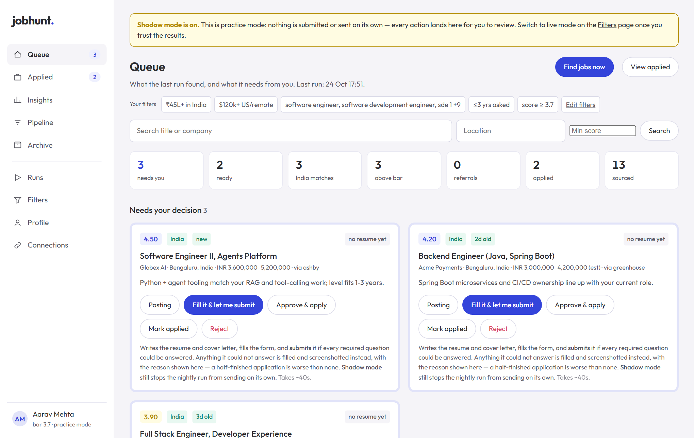
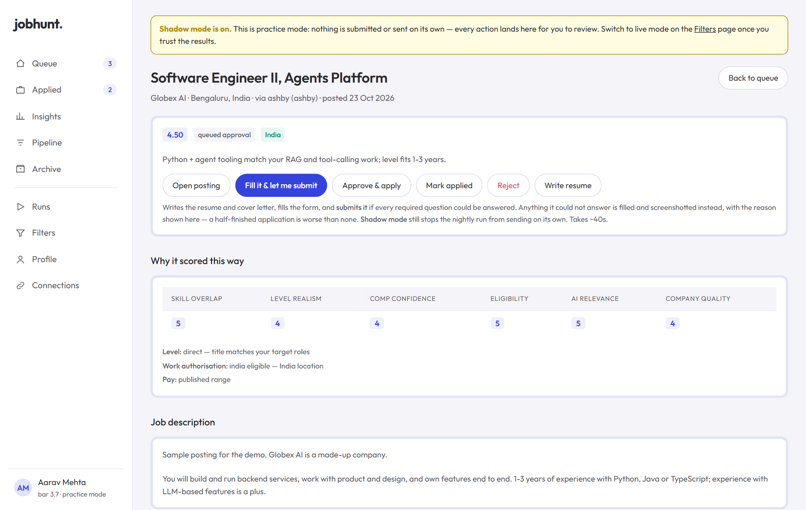
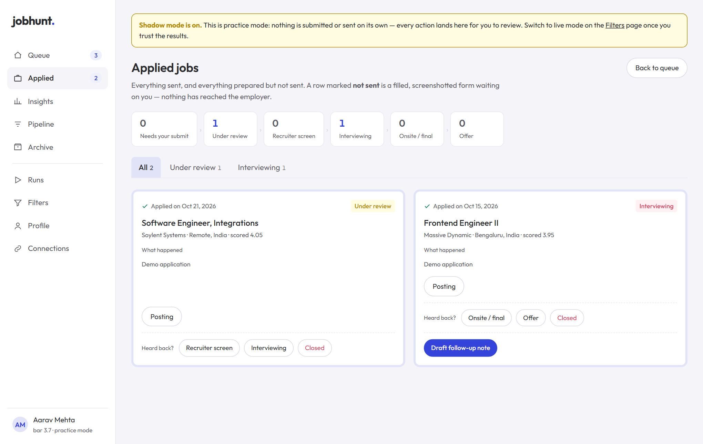
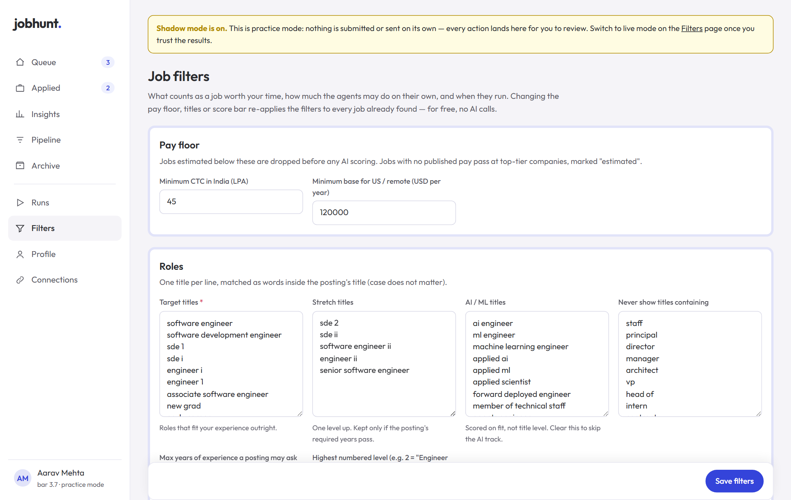
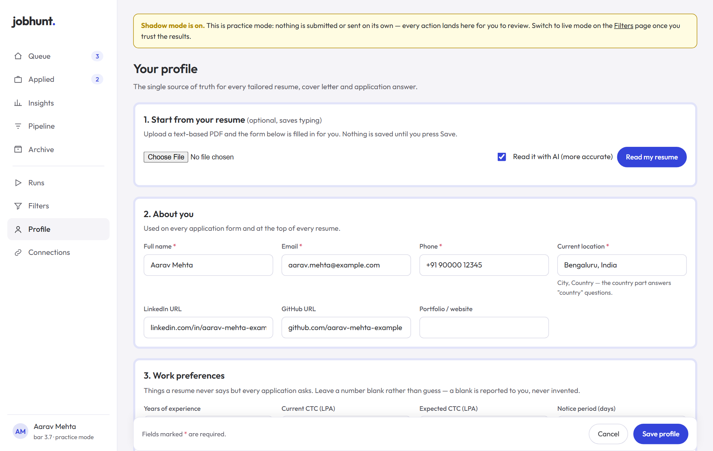

# Job Hunt Agents

[](https://github.com/RahulSankhla312/job-hunt-agents/actions/workflows/ci.yml)


[](LICENSE)

A team of AI agents that runs your job search on your own computer. It finds
openings, filters them by your rules, scores each one for fit, writes a
tailored resume and cover letter, finds people who could refer you, fills in
the application forms, and tracks the replies.

Everything is done from a dashboard in your browser. You fill in your profile
once. After that you press **Find jobs now**, or switch on the daily schedule,
and review what the agents prepared.

```
find → filter → score → tailor resume → referral ask → apply → follow up → track replies
```

Your resume, profile, applications and account sessions stay on your machine.
The only things sent anywhere are the AI calls (to Claude) and the job-board
and application-form requests themselves.



**Try it in two minutes, no setup:** `python run.py demo` opens the dashboard with
a made-up candidate and sample jobs. [Details below.](#try-the-demo-first)

> **Who it is built for.** Software engineers based in **India**, looking at
> India-based roles, worldwide-remote roles, and US roles that sponsor visas.
> Pay floors are in LPA (₹) and USD. Everything else, such as titles, levels,
> the score bar and the schedule, is yours to set on the Filters page.

---

## Contents

- [Screenshots](#screenshots)
- [Try the demo first](#try-the-demo-first)
- [What you need](#what-you-need)
- [Install](#install)
- [First run: the setup wizard](#first-run-the-setup-wizard)
- [Daily use](#daily-use)
- [Keeping it running](#keeping-it-running)
- [Safety rules](#safety-rules)
- [Configuration reference](#configuration-reference)
- [Command line](#command-line)
- [Troubleshooting](#troubleshooting)
- [Development](#development)

---

## Screenshots

| | |
|---|---|
|  |  |
| **Every score explained**: skill overlap, level, pay confidence, eligibility. | **Applied**: every application and where it stands, from review to offer. |
|  |  |
| **Filters**: pay floor, titles, score bar, sources, schedule. All from the UI. | **Profile**: import your resume PDF once; every form answer comes from here. |

All screenshots come from the built-in demo: the candidate and every company are made up.

---

## Try the demo first

After [installing](#install), run:

```bash
python run.py demo
```

It opens **http://127.0.0.1:8788** with a fictional candidate (Aarav Mehta) and a
dozen sample jobs at invented companies, in every stage: waiting for your
decision, ready, applied, archived and filtered out. Click around freely:

- The demo lives in its own `demo-data/` folder and is reset each time you start it.
  Your real profile, jobs and settings are never read or changed.
- It starts in practice mode, so nothing is ever submitted or sent.
- To use the app for real, stop the demo (`Ctrl+C`) and run `python run.py web`.

---

## What you need

| | |
|---|---|
| **Python 3.11 or newer** | [python.org/downloads](https://www.python.org/downloads/). On Windows, tick *"Add python.exe to PATH"* during install. |
| **An AI engine** (one of) | **Claude Code** signed in to your Claude subscription (no extra bill), *or* an **Anthropic API key** (pay per use). |
| **Git** | To clone this repository. |
| Google Chrome or Microsoft Edge | Optional but recommended. Used automatically if Playwright's own browser can't start on your machine. |

Optional extras, all connected from the dashboard:

- **LinkedIn account** to find people who could refer you (read-only).
- **Gmail** to send the recruiter emails you approve and track replies.

---

## Install

Open a terminal in the folder where you want the project.

**Windows (PowerShell or Command Prompt)**

```bash
git clone https://github.com/RahulSankhla312/job-hunt-agents.git
cd job-hunt-agents
python -m venv .venv
.venv\Scripts\python -m pip install -r requirements.txt
.venv\Scripts\python -m playwright install chromium
copy .env.example .env
.venv\Scripts\python run.py web
```

**macOS / Linux**

```bash
git clone https://github.com/RahulSankhla312/job-hunt-agents.git
cd job-hunt-agents
python3 -m venv .venv
.venv/bin/python -m pip install -r requirements.txt
.venv/bin/python -m playwright install --with-deps chromium
cp .env.example .env
.venv/bin/python run.py web
```

The last command starts the dashboard at **http://127.0.0.1:8787** and opens it
in your browser. Keep that terminal open while you use it; stop it with
`Ctrl+C`.

> Prefer a `jobhunt` command? `pip install -e .` inside the virtualenv adds
> one (`jobhunt web`, `jobhunt doctor`, and so on). `python run.py ...` and
> `python -m jobhunt ...` do exactly the same thing.

### Setting up the AI engine

The dashboard's **Connections** page checks this for you, but here is what it
needs:

- **Claude Code (recommended if you have a Claude subscription).** Install
  [Claude Code](https://claude.com/claude-code) and sign in once. On Windows,
  Connections has an **Open Claude sign-in window** button: type `/login` in
  the window that opens. The app finds the `claude` executable by itself (set
  `CLAUDE_CLI_PATH` in `.env` if it lives somewhere unusual).
- **Anthropic API key.** On Connections, choose *Anthropic API key*, paste
  the key, and press **Save and test**. It is stored only in this folder's
  `.env` file.

---

## First run: the setup wizard

The first time you open the dashboard it walks you through four steps. The rest
of the app stays locked until step 1 is saved.

### 1. Your profile

- **Start from your resume (optional).** Upload a text-based PDF and press
  **Read my resume**. The AI fills the whole form in about a minute. Nothing is
  saved until you press Save, so check every field first.
- **About you**: name, email, phone, city and country, LinkedIn and GitHub.
- **Work preferences**: current and expected CTC, notice period, preferred
  locations, remote and relocation. Leave a number blank rather than guess:
  the agents never invent an answer, they flag it for you.
- **Work authorisation**: citizenship, and whether you need sponsorship in
  India and abroad. Application forms are answered per posting from these.
- **Experience, education, projects, skills, achievements.** Tailored resumes
  may only *reorder and rephrase* what you write here. A fact-checker rejects
  any resume that mentions a company, number, technology or date that is not
  in your profile.
- **Standing answers** to voluntary questions on US forms (all optional).

### 2. Job filters

What counts as a job worth your time:

- **Pay floor**: minimum CTC in India, and minimum base for US/remote roles.
- **Roles**: target titles, stretch titles, AI/ML titles, titles to never
  show, the maximum years of experience a posting may ask for, and the highest
  numbered level (e.g. 2 = "Engineer II").
- **Match score**: jobs scoring at or above this reach your Queue.
- **Resume sent with applications**: *tailor it for each job* (reordered and
  rephrased from your profile to match the posting, fact-checked, one AI call
  per job), or *always send my own resume, unchanged* (upload your PDF here and
  it goes out exactly as it is, with no AI rewriting).
- **Autonomy**: *practice mode*, auto-submitting clean forms, cover letters.
- **Daily limits** and the **daily schedule** (times and timezone).

Changing the pay floor, titles or score bar later re-applies the filters to
every job already found. That costs nothing: no AI calls, no browsing.

### 3. Connections

- **AI engine** (required): pick the engine and press **Test now**.
- **LinkedIn** (optional): press **Sign in to LinkedIn**. A browser window
  opens; you sign in yourself, and the page notices when you are done. No
  password is ever typed, read or stored by this app. The session is kept in
  `data/playwright-profile/`, separate from your everyday browser.
- **Gmail** (optional):
  1. In [Google Cloud Console](https://console.cloud.google.com/apis/credentials),
     create a project, enable the **Gmail API**, and create an **OAuth client
     ID** of type **Desktop app**. Download its JSON.
  2. Upload that file on the Connections page.
  3. Press **Connect Gmail** and approve access in the tab that opens. Only two
     permissions are requested: send, and read.

### 4. Start

Press **Find jobs now**. The first run takes 10 to 30 minutes. You can watch
each step on the Runs page, or close the page and come back. Results appear
in your **Queue**.

---

## Daily use

| Page | What it is for |
|---|---|
| **Queue** | What needs you: jobs to approve, tailored jobs ready to apply to, and everything above your bar. Search by title, company, location or score. |
| **Job** (click any card) | Why it scored the way it did, the tailored resume, referral drafts. Buttons: *Write resume*, *Approve & apply*, *Fill it & let me submit*, *Reject*. |
| **Applied** | Every application and its stage (screen, interview, onsite, offer). Move it along after a call, or draft a follow-up note. |
| **Insights** | What actually converts, by source, company, score band and more. It declines to quote a percentage until there is enough data. |
| **Pipeline / Archive** | Every job by status, and every rejection with its reason, so you can see what the filters dropped. |
| **Runs** | Start a run now, turn the daily schedule on or off, see each run's history. *Rebuild outdated resumes* rewrites any resume made with an older layout or an older version of your profile. Outdated resumes are flagged on their job and are never sent. |
| **Filters / Profile / Connections** | Change anything you set up. |

### The two daily runs

- **Find & prepare jobs** (morning): pull new postings, filter, score with AI,
  write tailored resumes for the best few, draft referral asks.
- **Apply & follow up** (evening): release jobs whose referral window has
  passed, apply to ready jobs, draft recruiter emails, send the ones you
  approved, send follow-ups, and read replies from Gmail.

The gap gives a referral a working day to arrive before the application goes
out without one. A step that fails is recorded and the run carries on: one job
board being down must not cost you the day's applications.

### Where jobs come from

| Kind | Sources |
|---|---|
| Company career boards | Greenhouse, Ashby, Lever, SmartRecruiters, Workday, Amazon — 170+ companies in `config/company_tiers.yaml`, including Swiggy, Razorpay, Paytm, Meesho, CRED, Freshworks, ServiceNow, Agoda and more |
| LinkedIn job posts | LinkedIn's public (logged-out) job search: your search terms across India, plus a **watch list** of companies whose careers site can't be read directly (Zepto, Zomato, Nutanix, Flipkart, PhonePe, …). Your LinkedIn account is never used for this. You apply to these on LinkedIn yourself. |
| Wellfound | Indian startup jobs, often with the salary range |
| Free feeds | Remotive, RemoteOK, Arbeitnow, We Work Remotely, HN "Who is hiring" |
| LinkedIn (signed in) | Referral discovery only, read-only and rate-limited |

The watch list, search terms and a **"never show jobs from"** list (pre-filled
with IT-services and staffing firms) are on the Filters page under *Where to
look*. Companies you track by tier are scored first, so a day's scoring goes
to the employers you care about.

Not supported, on purpose: Naukri (it requires a CAPTCHA), Darwinbox-hosted
boards (behind bot protection), and anything that needs your login.

Add companies with `python run.py discover --names "Acme, Other Co" --append`.

---

## Keeping it running

The daily schedule runs **while the dashboard is running**. Turn it on from the
**Runs** page (or on Filters, under *Daily schedule*). A run missed because the
laptop was asleep happens once when it wakes (within 3 hours), not several
times.

To start the dashboard automatically when you log in on Windows, run this
once in a normal Command Prompt, from the project folder:

```bash
schtasks /Create /TN "JobHuntAgents" /SC ONLOGON /RL LIMITED /F /TR "'%CD%\.venv\Scripts\pythonw.exe' '%CD%\run.py' web --no-open"
```

On macOS/Linux, add `/path/to/.venv/bin/python /path/to/run.py web --no-open`
to your login items or a `systemd --user` service.

Only one run ever happens at a time, even across processes: pressing a button
while the schedule is mid-run just tells you a run is in progress.

---

## Safety rules

These are deliberate:

- **Practice mode is on by default.** Scheduled runs fill application forms
  and screenshot them, but never submit or send anything. You review, then
  submit from the dashboard. Switch it off on Filters once you trust the
  results.
- **Nothing ambiguous is submitted.** Even in live mode, auto-submit needs a
  known ATS (Greenhouse, Ashby, Lever), no unanswerable essay questions and no
  unfilled required field. A half-answered application is worse than none.
- **Clicking Approve is consent** for that one job: it tailors, fills and
  submits it (if the form is complete). The unattended schedule still obeys
  practice mode.
- **LinkedIn messages are drafted, never sent.** LinkedIn prohibits automated
  messaging, and your account matters more than any one referral.
- **Cold email is capped** (15/day by default), counted in the database.
- **Tailored resumes and letters are fact-checked** against your profile. Prefer
  your own resume word for word? Choose *send my own resume, unchanged* on Filters.
- **Gmail access is narrow**: two scopes, queries limited to application
  replies.
- **Rejections always carry a reason**, visible in Archive.
- **Polite scraping**: one throttled fetcher, per-host pacing, backoff on 429
  and 503, hard caps on LinkedIn searches and profile views.
- **The dashboard listens on 127.0.0.1 only** and refuses requests from other
  websites. `--host 0.0.0.0` makes it reachable from your phone on the same
  Wi-Fi; do that only on a network you trust.

---

## Configuration reference

You rarely need to touch files: the dashboard writes them. For reference:

| File | What it holds | In git? |
|---|---|---|
| `.env` | AI engine, API key, data folder, optional Google search key | **No** |
| `config/targets.yaml` | Shipped defaults for filters, limits and schedule | Yes |
| `config/company_tiers.yaml` | Companies to watch, their ATS, pay bands | Yes |
| `config/known_sponsors.yaml` | US employers that visibly sponsor visas | Yes |
| `data/profile/profile.yaml` | Your profile (from the setup page) | **No** |
| `data/profile/targets.yaml` | Your filter overrides, layered over `config/targets.yaml` | **No** |
| `data/jobs.db` | Every job, score, resume, application and run | **No** |
| `data/resumes/`, `data/cover_letters/`, `data/screenshots/` | Generated files | **No** |
| `data/playwright-profile/` | The signed-in browser session | **No** |
| `data/logs/` | `web.log`, `scheduler.log`, `cli.log` | **No** |

Everything personal lives under `data/` (change it with `JOBHUNT_DATA_DIR` in
`.env`). Back that folder up to keep your history; delete it to start over.

`.env` settings:

| Variable | Default | Meaning |
|---|---|---|
| `JOBHUNT_LLM_BACKEND` | `claude_cli` | `claude_cli` or `anthropic_api` |
| `CLAUDE_CLI_PATH` | *(auto)* | Path to the `claude` executable |
| `ANTHROPIC_API_KEY` | | For the `anthropic_api` engine |
| `JOBHUNT_DATA_DIR` | `data` | Where everything personal is stored |
| `JOBHUNT_BROWSER_CHANNEL` | *(auto)* | `chromium`, `chrome` or `msedge` to pin the browser |
| `GOOGLE_OAUTH_CLIENT_SECRET_FILE` | *(data/profile/client_secret.json)* | Gmail OAuth client |
| `GOOGLE_CSE_API_KEY`, `GOOGLE_CSE_CX` | | Optional Google Programmable Search for recruiter discovery (falls back to DuckDuckGo) |

---

## Command line

The dashboard covers everything, but every step is also a command. That's
useful for scripting and debugging. Run `python run.py --help` for the full
list.

| Command | What it does |
|---|---|
| `web [--port 8787] [--no-open]` | The dashboard |
| `demo [--port 8788]` | The dashboard with a made-up candidate and sample jobs, in its own folder |
| `doctor` | Check every dependency and connection |
| `run-now morning\|evening\|refilter` | One full run in the terminal |
| `schedule` | The daily scheduler without the dashboard (`--install` prints a Windows logon-task command) |
| `onboard` | Build the profile from a resume in the terminal (the setup page does the same) |
| `source`, `gate`, `score`, `tailor`, `apply`, `referrals`, `outreach`, `track` | Individual pipeline steps |
| `handover --job-id N` | Fill a form in a visible window and let you press Submit |
| `login`, `gmail-auth` | Terminal versions of the Connections page |
| `discover --names "A, B" --append` | Find a company's ATS board and add it |
| `digest` | What happened, and what needs you |

---

## Troubleshooting

**Start with `python run.py doctor`.** It checks Python, the database, the AI
engine, the browser, the job sources and your connections, and says what to
fix.

| Problem | Fix |
|---|---|
| Connections says the AI engine is *Not working* | Claude Code: sign in (`/login`) and press **Test now**. API key: check it and press **Save and test**. |
| `playwright` fails in doctor, or "Executable doesn't exist" | `python -m playwright install chromium` |
| A browser window will not open (LinkedIn sign-in, *Fill it & let me submit*) | The app already falls back to installed Chrome, then Edge. If neither is installed, install Chrome, or pin a browser with `JOBHUNT_BROWSER_CHANNEL`. |
| "another run is still in progress" | Only one run happens at a time. Wait for it, or check the Runs page. |
| The resume import filled things in wrongly | It's a draft: fix the fields and save, or press *discard it*. For best results use a text-based PDF (not a scan) with AI reading switched on. |
| Nothing above the bar | Lower the pay floor or score on **Filters**. The change is re-applied to existing jobs at once. |
| The schedule did not run | It only runs while the dashboard is running. See [Keeping it running](#keeping-it-running). |
| Something else broke | Read `data/logs/web.log`. Error pages also say where the log is. |

---

## Development

```bash
pip install -e ".[dev]"
python -m pytest        # 560+ tests, runs against a throwaway data folder
ruff check .
```

Tests never touch your real `data/`: `tests/conftest.py` points
`JOBHUNT_DATA_DIR` at a temporary folder and installs a fictional profile.
CI (`.github/workflows/ci.yml`) runs lint and tests on Linux and Windows.

```
jobhunt/
  cli.py      command line (run.py and `python -m jobhunt` call it)
  config.py   settings, data paths, layered YAML config
  llm/        AI engine adapter: Claude Code CLI | Anthropic API
  sources/    Greenhouse, Ashby, Lever, Workday, Amazon, free feeds, discovery,
              contacts, Gmail, browser/{session, linkedin}
  agents/     scout, gatekeeper, analyst, tailor, writer, connector,
              applicant, outreach, tracker, onboard
  graph/      pipeline (morning/evening/refilter), runner, scheduler
  resume/     profile schema + fact registry, PDF parsing, rendering
  store/      SQLModel schema + SQLite
  web/        dashboard: app, onboarding, runs, connections, templates/
  util/       cross-process run lock
config/       shipped defaults
tests/        pytest suite (fixtures/ holds a fictional profile)
```

---

## License

MIT. See [LICENSE](LICENSE).
